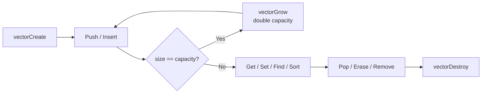

# Dynamic Array in C

[](https://en.wikipedia.org/wiki/C99)
[](LICENSE)

A dynamic array (vector) implemented in C, modeled after C++ `std::vector`. Supports dynamic growth, random access, insertion/deletion, lookup, sorting, and batch operations.

## Project Overview

This project provides a reusable dynamic array library written in standard C99. The goal is to offer a safe, efficient, and easy-to-integrate vector type for C projects that lack built-in dynamic containers.

Key capabilities:

- **Dynamic growth** — capacity doubles when full, amortized O(1) push.
- **Memory safety** — NULL pointer guards, bounds checks, `realloc` failure handling, integer overflow protection.
- **Complete API** — create/destroy, push/pop, get/set, insert/erase, find/count, sort/reverse, copy/swap.
- **Configurable element type** — change the `Data` typedef to store any type.
- **Header/implementation split** — compiles as a static or shared library.



## Dependencies

Only the C standard library:

[](https://en.cppreference.com/w/c/io)
[](https://en.cppreference.com/w/c/memory)
[](https://en.cppreference.com/w/c/types/boolean)
[](https://en.cppreference.com/w/c/string/byte)
[](https://en.cppreference.com/w/c/types/limits)

Supported compilers: GCC, Clang, MSVC, MinGW.

## Project Structure

```
.
├── 动态数组.h      # Library header (struct + declarations)
├── 动态数组.c      # Library implementation
├── test_vector.c  # Test suite
├── Makefile       # Build script (static/shared lib + tests)
├── LICENSE        # MIT License
├── README.md      # English documentation (this file)
└── README.zh.md   # 中文文档
```

## Usage

### Build the Library

```bash
# Static library (libvector.a)
gcc -std=c99 -Wall -Wextra -c -o 动态数组.o 动态数组.c
ar rcs libvector.a 动态数组.o

# Shared library — Windows (MinGW)
gcc -shared -o libvector.dll 动态数组.o

# Shared library — Linux
gcc -shared -fPIC -o libvector.so 动态数组.o
```

Or use the Makefile:

```bash
make static   # static library
make shared   # shared library
make test     # build and run tests
make all      # static + shared
```

### Run Tests

```bash
# Compile sources directly
gcc -std=c99 -Wall -Wextra -o test_vector test_vector.c 动态数组.c
./test_vector

# Or link against the static library
gcc -std=c99 -Wall -Wextra -o test_vector test_vector.c -L. -lvector
./test_vector
```

### Integrate into Your Project

Add `动态数组.h` and `动态数组.c` (or the compiled library) to your project, then include the header.

```c
#include "动态数组.h"

int main(void) {
    Vector* v = vectorCreate();
    vectorPush(v, 10);
    vectorPush(v, 20);
    vectorPush(v, 30);
    vectorPrint(v);          // [10, 20, 30] (size=3, capacity=4)

    vectorInsert(v, 1, 15);  // insert 15 at index 1
    vectorErase(v, 2);       // erase element at index 2

    vectorSort(v);
    vectorReverse(v);

    vectorDestroy(v);
    return 0;
}
```

Compile with the implementation or the library:

```bash
gcc -std=c99 -o myapp myapp.c 动态数组.c          # source
gcc -std=c99 -o myapp myapp.c -L. -lvector        # static lib
```

## API Reference

### Create & Destroy

| Function | Description |
| --- | --- |
| `Vector* vectorCreate(void)` | Create a vector, default capacity 4 |
| `Vector* vectorCreateWithCapacity(int n)` | Create with a given capacity (`n > 0`) |
| `void vectorDestroy(Vector* v)` | Destroy and free memory |

### Basic Access

| Function | Description |
| --- | --- |
| `void vectorPush(Vector* v, Data val)` | Append an element |
| `void vectorPop(Vector* v)` | Remove the last element |
| `Data vectorGet(Vector* v, int idx)` | Get element at `idx` (0 on out-of-bounds) |
| `void vectorSet(Vector* v, int idx, Data val)` | Set element at `idx` |
| `Data* vectorAt(Vector* v, int idx)` | Get pointer to element at `idx` (NULL on out-of-bounds) |
| `Data vectorFront(Vector* v)` | First element |
| `Data vectorBack(Vector* v)` | Last element |

### Capacity

| Function | Description |
| --- | --- |
| `void vectorReserve(Vector* v, int n)` | Reserve capacity (grow only) |
| `void vectorResize(Vector* v, int n)` | Resize; new elements are zero-initialized |
| `void vectorShrinkToFit(Vector* v)` | Shrink capacity to current size |
| `void vectorClear(Vector* v)` | Clear elements (keep memory) |
| `bool vectorIsEmpty(Vector* v)` | Check if empty |
| `int vectorSize(Vector* v)` | Element count |
| `int vectorCapacity(Vector* v)` | Current capacity |
| `Data* vectorData(Vector* v)` | Raw data pointer |

### Insert & Erase

| Function | Description |
| --- | --- |
| `void vectorInsert(Vector* v, int idx, Data val)` | Insert at `idx` |
| `void vectorErase(Vector* v, int idx)` | Erase element at `idx` |
| `void vectorRemove(Vector* v, Data val)` | Remove the first element equal to `val` |

### Lookup

| Function | Description |
| --- | --- |
| `int vectorFind(Vector* v, Data val)` | Index of first match, or -1 |
| `bool vectorContains(Vector* v, Data val)` | Whether `val` exists |
| `int vectorCount(Vector* v, Data val)` | Count occurrences of `val` |

### Batch Operations

| Function | Description |
| --- | --- |
| `void vectorPushArray(Vector* v, Data* arr, int n)` | Append `n` elements |
| `void vectorCopy(Vector* src, Vector* dest)` | Copy `src` into `dest` |
| `void vectorSwap(Vector* a, Vector* b)` | Swap two vectors in O(1) |
| `void vectorReverse(Vector* v)` | Reverse elements |
| `void vectorSort(Vector* v)` | Sort via `qsort` (O(n log n)) |

### Output

| Function | Description |
| --- | --- |
| `void vectorPrint(Vector* v)` | Print contents with size and capacity |

## Data Structure

```c
typedef int Data;  // element type; change as needed

typedef struct {
    Data* data;      // data buffer
    int size;        // element count
    int capacity;    // allocated capacity
} Vector;
```

## Custom Element Types

The vector stores `int` by default. Change the typedef to switch types:

```c
typedef double Data;
```

For structs, store pointers:

```c
typedef struct { char name[32]; int age; } Person;
typedef Person* Data;
```

## Complexity

| Operation | Average | Worst |
| --- | --- | --- |
| Push | O(1) | O(n) |
| Pop | O(1) | O(1) |
| Get / Set | O(1) | O(1) |
| Insert / Erase | O(n) | O(n) |
| Find / Contains | O(n) | O(n) |
| Sort | O(n log n) | O(n log n) |
| Reverse | O(n) | O(n) |

## Contributing

Issues and pull requests are welcome. Before submitting, please make sure:

- Code compiles cleanly with `gcc -std=c99 -Wall -Wextra`.
- All tests pass (`./test_vector`).

## License

MIT — see [LICENSE](LICENSE).

## Author

Dr. Ailan Anjuxi (谙弆悕博士)

- 📫 Email: anjuxi.ME@outlook.com
- 📞 SIP: sip:anjuxi@sip.linphone.org
