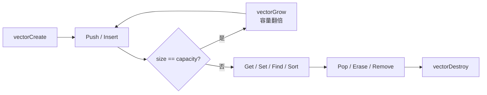

# 动态数组 C 语言实现

[](https://en.wikipedia.org/wiki/C99)
[](LICENSE)

用 C 语言实现的动态数组（Vector），对标 C++ 的 `std::vector`，支持动态扩容、随机访问、插入删除、查找、排序、批量操作。

> 英文版文档见 [README.md](README.md)。

## 项目介绍

本项目提供一个用标准 C99 编写的可复用动态数组库。目标是为缺少内置动态容器的 C 项目提供一个安全、高效、易于集成的 vector 类型。

主要能力：

- **动态扩容** — 容量不足时翻倍增长，push 摊销 O(1)。
- **内存安全** — NULL 指针检查、越界检查、realloc 失败处理、整数溢出防护。
- **完整 API** — 创建销毁、增删改查、插入删除、查找计数、排序反转、复制交换。
- **可配置元素类型** — 修改 `Data` typedef 即可切换存储类型。
- **头文件与实现分离** — 可编译为静态库或动态库。



## 依赖说明

仅依赖 C 标准库：

[](https://en.cppreference.com/w/c/io)
[](https://en.cppreference.com/w/c/memory)
[](https://en.cppreference.com/w/c/types/boolean)
[](https://en.cppreference.com/w/c/string/byte)
[](https://en.cppreference.com/w/c/types/limits)

支持编译器：GCC、Clang、MSVC、MinGW。

## 项目结构

```
.
├── 动态数组.h      # 库头文件（结构体 + 函数声明）
├── 动态数组.c      # 库实现
├── test_vector.c  # 测试代码
├── Makefile       # 编译脚本（静态库/动态库/测试）
├── LICENSE        # MIT 许可证
├── README.md      # English documentation
└── README.zh.md   # 中文文档（本文件）
```

## 使用说明

### 编译库

```bash
# 静态库 (libvector.a)
gcc -std=c99 -Wall -Wextra -c -o 动态数组.o 动态数组.c
ar rcs libvector.a 动态数组.o

# 动态库 — Windows (MinGW)
gcc -shared -o libvector.dll 动态数组.o

# 动态库 — Linux
gcc -shared -fPIC -o libvector.so 动态数组.o
```

或直接使用 Makefile：

```bash
make static   # 静态库
make shared   # 动态库
make test     # 编译并运行测试
make all      # 静态库 + 动态库
```

### 运行测试

```bash
# 直接编译源文件
gcc -std=c99 -Wall -Wextra -o test_vector test_vector.c 动态数组.c
./test_vector

# 或链接静态库
gcc -std=c99 -Wall -Wextra -o test_vector test_vector.c -L. -lvector
./test_vector
```

### 集成到项目

将 `动态数组.h` 和 `动态数组.c`（或编译好的库文件）加入项目，include 头文件即可。

```c
#include "动态数组.h"

int main(void) {
    Vector* v = vectorCreate();
    vectorPush(v, 10);
    vectorPush(v, 20);
    vectorPush(v, 30);
    vectorPrint(v);          // [10, 20, 30] (size=3, capacity=4)

    vectorInsert(v, 1, 15);  // 在索引1处插入15
    vectorErase(v, 2);       // 删除索引2处的元素

    vectorSort(v);
    vectorReverse(v);

    vectorDestroy(v);
    return 0;
}
```

编译时链接实现文件或库：

```bash
gcc -std=c99 -o myapp myapp.c 动态数组.c          # 源文件
gcc -std=c99 -o myapp myapp.c -L. -lvector        # 静态库
```

## API 文档

### 创建与销毁

| 函数 | 说明 |
| --- | --- |
| `Vector* vectorCreate(void)` | 创建动态数组，默认容量 4 |
| `Vector* vectorCreateWithCapacity(int n)` | 指定容量创建，n 需大于 0 |
| `void vectorDestroy(Vector* v)` | 销毁并释放内存 |

### 基本读写

| 函数 | 说明 |
| --- | --- |
| `void vectorPush(Vector* v, Data val)` | 尾部追加元素 |
| `void vectorPop(Vector* v)` | 尾部删除元素 |
| `Data vectorGet(Vector* v, int idx)` | 获取 idx 处元素，越界返回 0 |
| `void vectorSet(Vector* v, int idx, Data val)` | 设置 idx 处元素 |
| `Data* vectorAt(Vector* v, int idx)` | 获取 idx 处元素指针，越界返回 NULL |
| `Data vectorFront(Vector* v)` | 首元素 |
| `Data vectorBack(Vector* v)` | 尾元素 |

### 容量管理

| 函数 | 说明 |
| --- | --- |
| `void vectorReserve(Vector* v, int n)` | 预留容量，只扩容不缩容 |
| `void vectorResize(Vector* v, int n)` | 调整元素个数，扩容区用 0 填充 |
| `void vectorShrinkToFit(Vector* v)` | 收缩容量到当前 size |
| `void vectorClear(Vector* v)` | 清空元素，不释放内存 |
| `bool vectorIsEmpty(Vector* v)` | 是否为空 |
| `int vectorSize(Vector* v)` | 元素个数 |
| `int vectorCapacity(Vector* v)` | 当前容量 |
| `Data* vectorData(Vector* v)` | 原始数据指针 |

### 插入删除

| 函数 | 说明 |
| --- | --- |
| `void vectorInsert(Vector* v, int idx, Data val)` | 在 idx 处插入 |
| `void vectorErase(Vector* v, int idx)` | 删除 idx 处元素 |
| `void vectorRemove(Vector* v, Data val)` | 删除第一个等于 val 的元素 |

### 查找

| 函数 | 说明 |
| --- | --- |
| `int vectorFind(Vector* v, Data val)` | 返回首个匹配索引，未找到返回 -1 |
| `bool vectorContains(Vector* v, Data val)` | 是否包含 val |
| `int vectorCount(Vector* v, Data val)` | val 出现次数 |

### 批量操作

| 函数 | 说明 |
| --- | --- |
| `void vectorPushArray(Vector* v, Data* arr, int n)` | 追加 n 个元素 |
| `void vectorCopy(Vector* src, Vector* dest)` | 复制 src 到 dest |
| `void vectorSwap(Vector* a, Vector* b)` | 交换两个数组（O(1)） |
| `void vectorReverse(Vector* v)` | 反转 |
| `void vectorSort(Vector* v)` | 排序（qsort，O(n log n)） |

### 输出

| 函数 | 说明 |
| --- | --- |
| `void vectorPrint(Vector* v)` | 打印内容及 size、capacity |

## 数据结构

```c
typedef int Data;  // 元素类型，按需修改

typedef struct {
    Data* data;      // 数据缓冲区
    int size;        // 元素个数
    int capacity;    // 已分配容量
} Vector;
```

## 自定义元素类型

默认存储 `int`，修改 typedef 即可切换：

```c
typedef double Data;
```

存储结构体时使用指针：

```c
typedef struct { char name[32]; int age; } Person;
typedef Person* Data;
```

## 复杂度

| 操作 | 平均 | 最坏 |
| --- | --- | --- |
| Push | O(1) | O(n) |
| Pop | O(1) | O(1) |
| Get / Set | O(1) | O(1) |
| Insert / Erase | O(n) | O(n) |
| Find / Contains | O(n) | O(n) |
| Sort | O(n log n) | O(n log n) |
| Reverse | O(n) | O(n) |

## 贡献指南

欢迎提交 Issue 和 Pull Request。提交前请确保：

- 代码通过 `gcc -std=c99 -Wall -Wextra` 编译无警告。
- 所有测试通过（`./test_vector`）。

## 许可证

MIT — 详见 [LICENSE](LICENSE)。

## 联系作者

谙弆悕博士（Dr. Ailan Anjuxi）

- 📫 邮箱：anjuxi.ME@outlook.com
- 📞 SIP 电话：sip:anjuxi@sip.linphone.org
